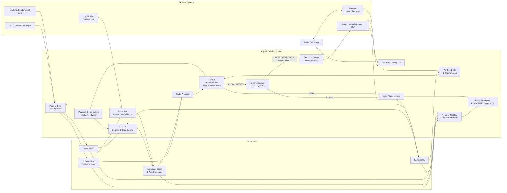
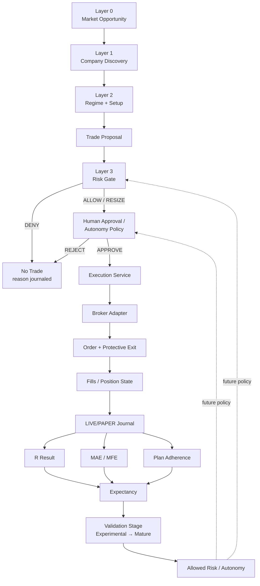
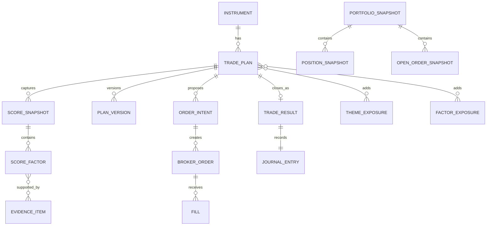
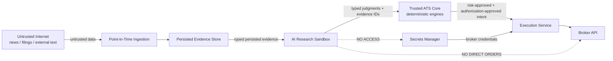
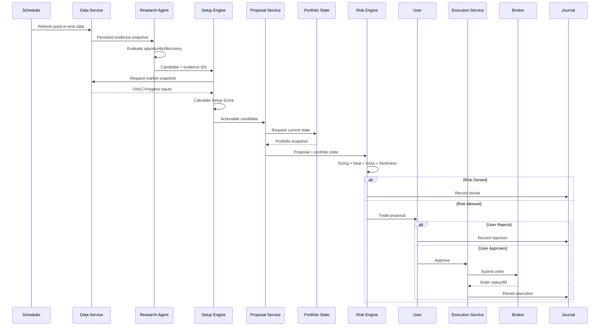
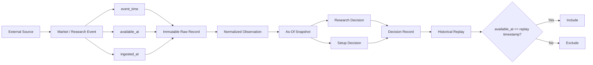
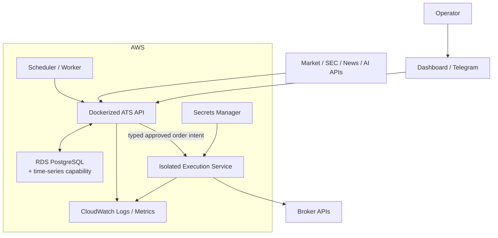

# ATS Architecture Baseline v1.1

Status: **Implementation baseline**

This version refines v1 by adding an explicit human-approval boundary, point-in-time research provenance, Portfolio State/Reconciliation, run-type separation, a clearer data model, runtime sequence, and event lineage.

## Architectural invariants

1. `playbook_v3.yaml` is the source of truth for deterministic strategy rules.
2. AI produces evidence and qualitative judgments; it does not control capital.
3. The Layer 3 Risk Engine is non-bypassable.
4. Risk authorization and human trade approval are separate decisions.
5. Research decisions consume persisted point-in-time evidence, not ephemeral web state.
6. LIVE, PAPER, and REPLAY outcomes are distinguishable and cannot silently contaminate one another.
7. Portfolio/account state enters the Risk Engine through a defined Portfolio State contract.
8. Broker-specific code remains behind an adapter.
9. Every production decision must be reproducible from stored inputs, config version, code version, and timestamps.
10. Historical replay must never reveal information unavailable at the requested as-of timestamp.

## 1. System architecture

## 2. Trading decision flow

## 3. Core data architecture

`INSTRUMENT` replaces the ambiguous entity name `SECURITY`.

A trade can reference multiple decision-time score snapshots: Market Opportunity, Discovery, Setup, and Regime.

Recommended `SCORE_SNAPSHOT.score_type` values:

- `MARKET_OPPORTUNITY`
- `DISCOVERY`
- `SETUP`
- `REGIME`

Decision-time plans and score snapshots are immutable. Re-planning or re-scoring creates another version/snapshot.

## 4. Portfolio State contract

The Risk Engine must receive a defined state object rather than query arbitrary broker/database fields.

Minimum inputs:

- account equity / NLV
- available cash or buying power, with provenance
- current positions
- open orders
- current total open R
- theme and factor heat
- daily realized R
- weekly realized R
- strategy validation stage
- state timestamp and freshness
- source/provenance
- run type: LIVE, PAPER, or REPLAY

The Portfolio State/Reconciliation component owns broker/account normalization. The Risk Engine owns risk decisions.

## 5. Trust boundaries

## 6. Runtime trade sequence

## 7. Point-in-time event lineage

Acceptance invariant: **replaying yesterday must not reveal information learned today.**

## 8. LIVE / PAPER / REPLAY separation

Every outcome-bearing record must carry an explicit run type.

- `LIVE`: real broker execution.
- `PAPER`: broker sandbox or controlled simulated execution using current data.
- `REPLAY`: historical as-of simulation.

Shared analytics may aggregate them only when the query explicitly requests that aggregation. Live validation-stage promotion must never silently count replay observations.

## 9. Deployment view

## 10. Architecture-to-sprint impact

- Sprint 2: immutable evidence, plans, and score snapshots remain foundational.
- Sprint 3: Risk Engine remains authoritative; Portfolio State becomes its explicit input contract.
- Sprint 4: implement point-in-time lineage and run-type-safe replay.
- Sprint 5: regime/setup outputs create typed score snapshots.
- Sprint 6: backtests write REPLAY results only.
- Sprint 7–8: AI consumes persisted evidence and returns typed judgments/evidence references.
- Sprint 9: implement Human Approval/Autonomy Policy and broker adapter path.
- Sprint 10: harden execution isolation, observability, journal analytics, and promotion rules.
